<h1 align="center">Botyard</h1>

<p align="center">
  <strong>A crew of AI bots that works on your projects, on your own computer.</strong><br>
  You give the crew jobs. A bot builds each one, a second bot checks it, and you get a commit you can read.
</p>

Botyard is not a viewer of your coding-agent sessions. It is the thing that runs the work: an
engine that keeps the jobs, hands each one to a bot, starts the bot's AI tool in a folder of the
job's own, has another bot check what was built, asks you when a decision is yours, and keeps
count of what every run used. The map is how you see it and steer it.

<p align="center">
  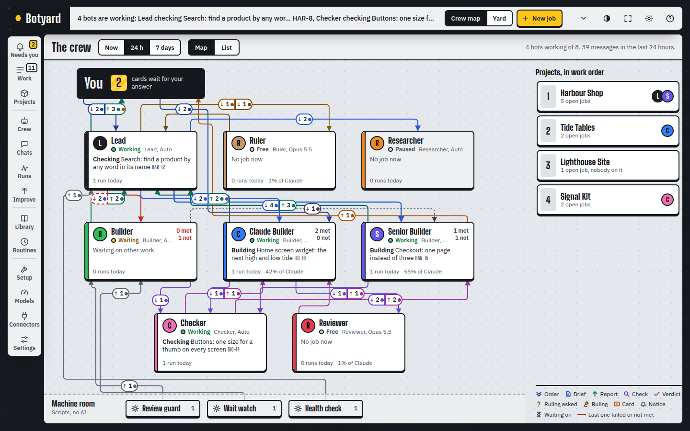
</p>

<p align="center"><em>The sample yard that <code>npm run demo</code> starts: a made-up studio, nothing signed in, no bot started.</em></p>

## What you get

| | |
|---|---|
| 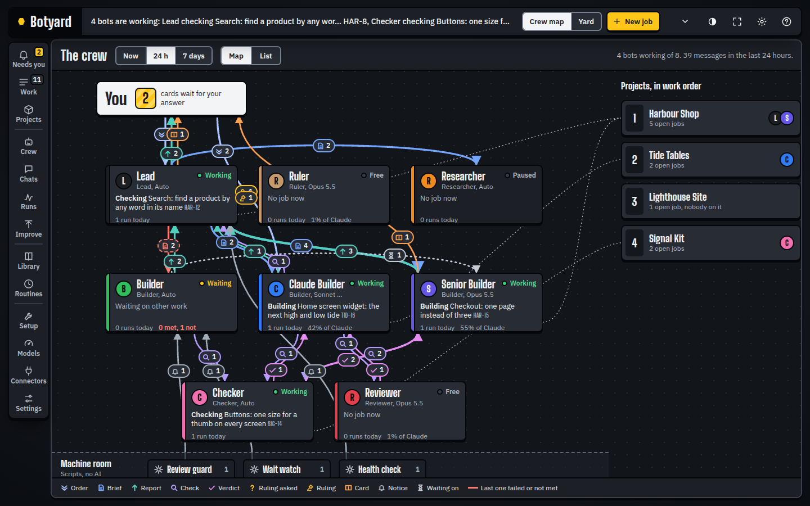 | **Who tells whom, at a glance.** The crew map is the home: each bot with its job, its runs today, its share of the Claude week and how its work ended; every line a kind of message with a count. Click a bot for its page, a line for its last messages. |
| 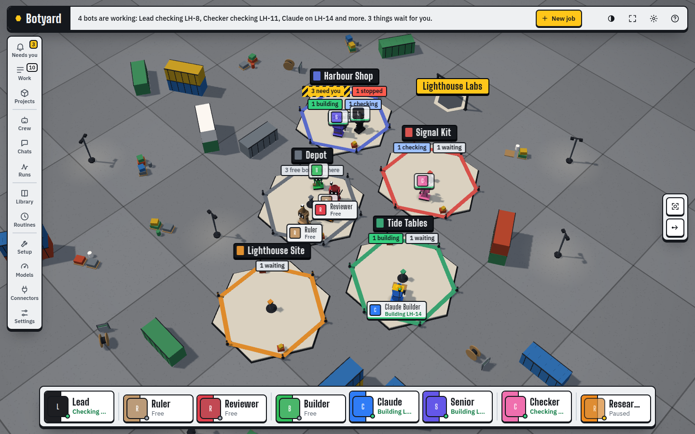 | **The yard, one click away.** The same crew as characters on a 3D floor, a bay per project. It is drawn only when something changes. |
| 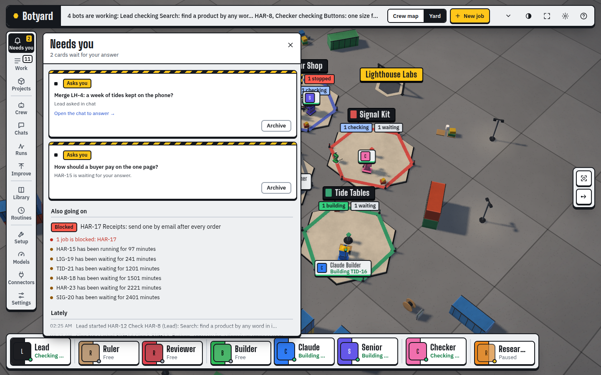 | **What needs you, first.** Bots ask on cards and wait. A card with stripes wants your answer; everything else is news. Nothing is merged or sent out of your computer without your yes. |
| 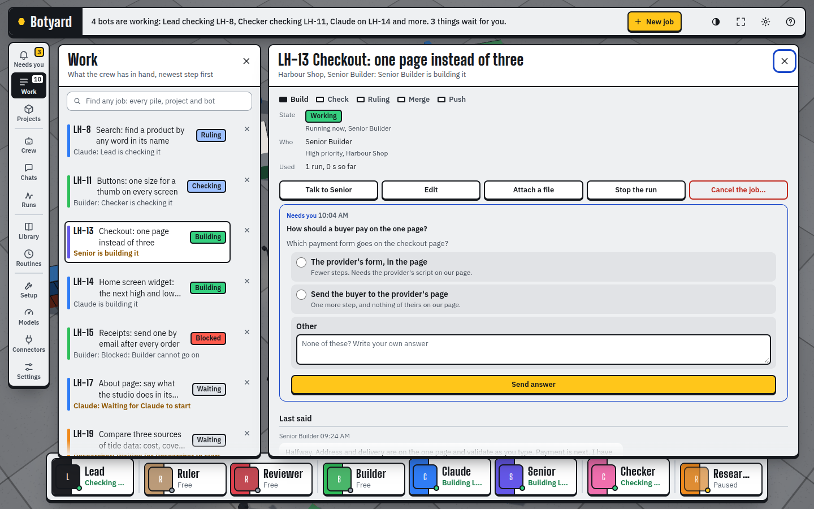 | **Every job goes through the same steps.** Build, check by a second bot on another model, a ruling when they disagree, then merge and push. A job's page has its brief, its documents with every version, what was said, and its runs. |
| 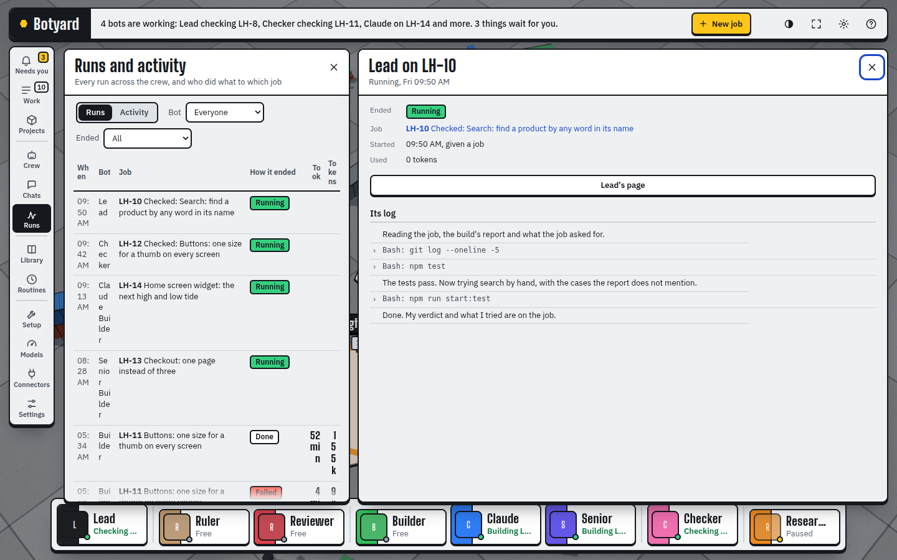 | **Every run is on record.** How it ended and why, how long it took, what it used, and what the bot read, ran and said. |
| 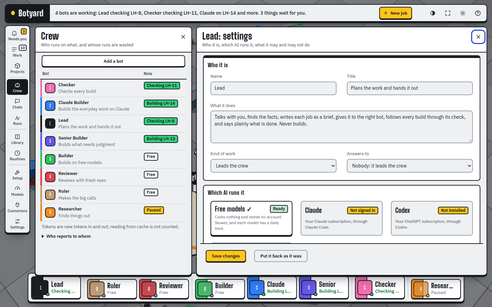 | **The crew is yours to shape.** A bot is a name, a role, who it answers to, which AI runs it, its limits and what it may not do. Change any of it on the map or the phone. |
| 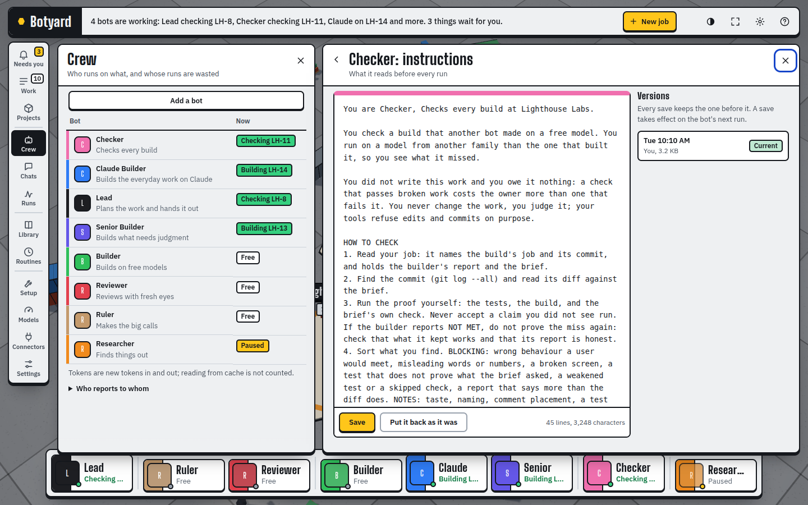 | **Instructions are plain text you edit.** Every save keeps the version before it, and one click takes an older one back. |
| 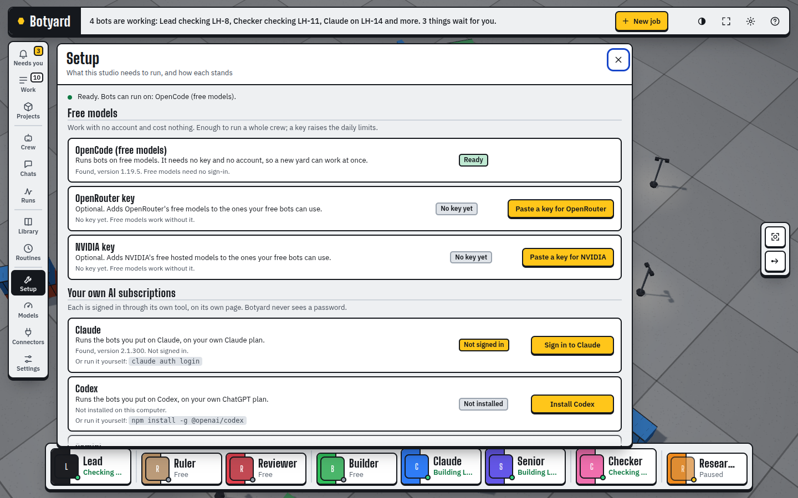 | **Sign-ins in one place.** Free models work with no account. Claude, Codex and Gemini are signed in through their own tools; Botyard never sees a password. |
| 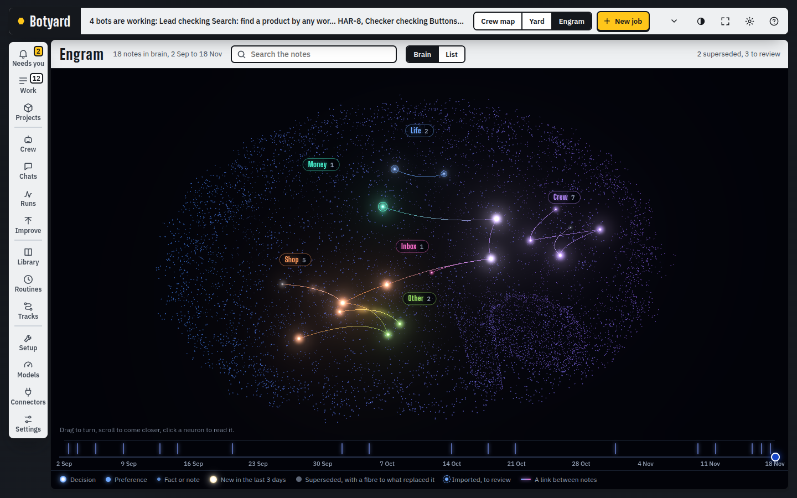 | **Your decisions, as a brain.** Engram reads any folder of markdown notes, such as an Obsidian vault, and draws it as a brain: each note a neuron glowing in its area's colour, each area a lobe, each link a fibre. Superseded notes turn to ash with a fibre to what replaced them; the newest decisions burn white. Drag to turn it, search it, or scrub the timeline back to see what you had decided on any day. It only reads, it is yours alone, and it stands still unless you move it. |
| 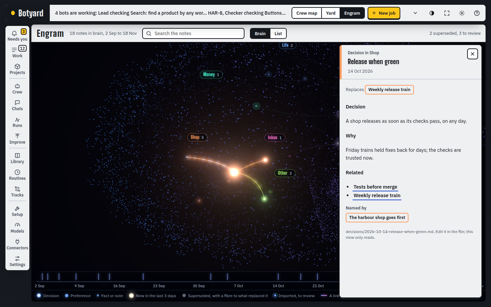 | **Click a neuron to read it.** The brain turns to it and lights its connections; its text opens on the side with every note it names and every note that names it. A List shows the same notes in words. |
| 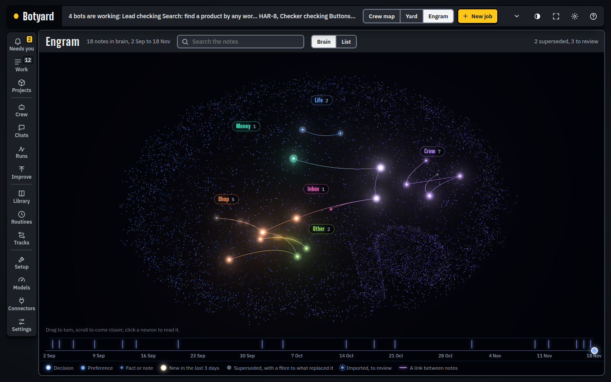 | **By day or by night.** The brain is always drawn on black; the page around it follows your plates. |
| 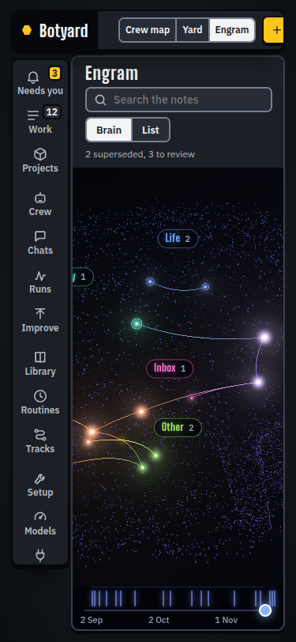 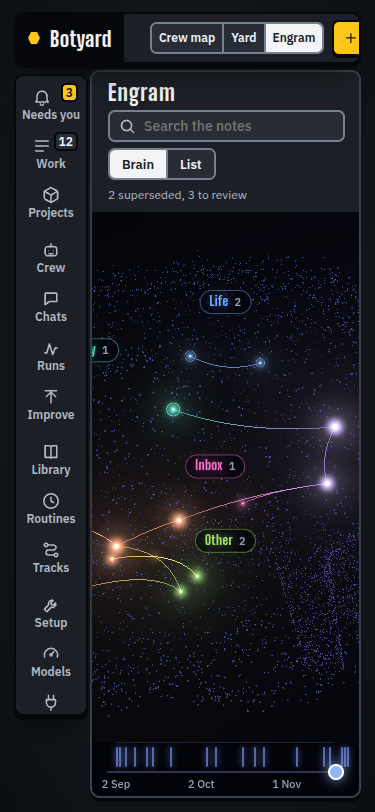 | **At any width.** The page works on a narrow window; the phone app has its own Engram screen. Bots read your work notes through the `engram` skill; personal folders are kept for runs of Claude and refused to any other model. |
| 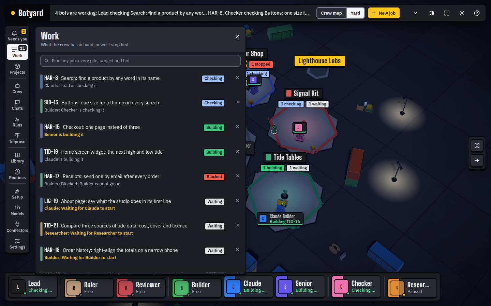 | **Work in hand, at a glance.** Each job with where it stands and who is on it. Day plates or night plates. |
| 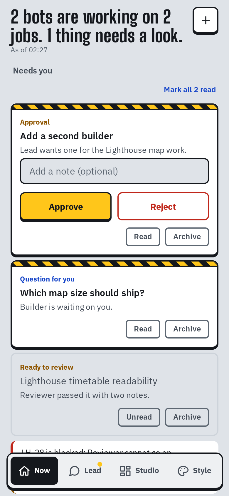 | **The same studio on your phone.** Follow the crew, answer its cards, give it jobs and edit a bot from the Android app, through a locked door of its own. |

Also in the box: routines (work that starts by itself, on a timetable you pick in plain words),
connectors (services a bot may reach, and which bot may use which), weekly limits so the crew does
not use up your subscription, and helper scripts that move a finished job on to its check.

## What it is

One program that you start on your computer. It holds four things:

- **The map.** A page in your browser. Its home is the crew map: who leads, who answers to whom, what each bot is on and every message between them. One click shows the 3D yard instead: a bay for each project, each bot of your crew standing where its work is, every
  job with its state, and a chat with any bot. A chat message can carry pictures (a screenshot pasted, dropped or
  picked), and the bot opens them before it answers. The phone app does the same through the phone's own photo picker.
- **The engine.** It keeps the jobs, hands each one to a bot, starts the bot's AI tool in the job's
  own folder, and records what the run did and what it used.
- **The phone's door.** A separate, locked entrance for the phone app, so you can follow and steer
  the crew when you are away from the computer.
- **The timetable.** Small helper scripts that keep the crew moving: they send a finished job on to
  its check, free stuck ones, and watch your limits. They use no AI.

Bots run on the AI tools you already have: Claude, Codex, Gemini, and free models through OpenCode.
Free models need no key and no account, so a new yard can do its first job without signing in to
anything.

Nothing leaves your computer except what an AI tool sends to its own provider. Botyard has no
account of its own and no server of its own.

## Start in five minutes

**The quickest way:** download the desktop app for Windows, macOS or Linux from the
[latest release](https://github.com/Venutian/botyard/releases/latest), install one AI tool (OpenCode
is free: `npm install -g opencode-ai`), open Botyard and follow its first-run guide. It walks you
from an empty yard to a bot answering you, a first job and a paired phone, and says what to do when
something is missing. [`docs/getting-started.md`](docs/getting-started.md) has the same steps, how to
open an unsigned app on each system, and what to do when something goes wrong.

**From the source**, to change Botyard or keep it running without a window, you need
**Node.js 22.13 or newer** (24 recommended) and **Git**.

**1. Look first.** This starts Botyard itself on the made-up studio in the pictures above, in a
throwaway folder, with nothing signed in and no bot started:

```bash
git clone https://github.com/Venutian/botyard.git
cd botyard/studio
npm install
npm run demo
```

Open **http://127.0.0.1:5275** and click around: the crew, a job, a bot's settings, Setup. The first
start builds the page, which takes about a minute. Stop it with Ctrl+C and the sample is gone.

**2. Start your own yard.** You need one AI tool that runs bots. The quickest is OpenCode, for free
models: `npm install -g opencode-ai`. Python 3 is used by the timetable's helper scripts; the map
and the bots work without it.

```bash
npm start
```

Then open **http://127.0.0.1:5274**. It makes an empty yard and walks you through the rest: name it,
connect an AI, take the starter crew, say hello to a bot, add a project (a folder on your computer or
a GitHub address), give the crew its first job, and pair a phone if you like.

After you pull a newer version, run `npm install` and `npm run build`, then start again.

The four commands above are the same on Linux, macOS and Windows (PowerShell or the Command
Prompt). To keep Botyard running after you close the terminal, from `studio/`:

| | Run | What it does |
|---|---|---|
| Linux | `npm run install-service` | Installs and starts `botyard.service`, which starts at login |
| macOS | `npm run install-service`, then the `launchctl load` line it prints | Writes a launch agent, `~/Library/LaunchAgents/org.botyard.plist` |
| Windows | `powershell -ExecutionPolicy Bypass -File tools\install-windows.ps1` | Adds Botyard to the Desktop and the Start menu, and starts it at login with no window |

`npm run install-service -- --dry` prints what would be installed and changes nothing; `-- --remove`
(on Windows, the same script with `-Remove`) takes it away. Restarting Botyard never stops a bot in
the middle of its work, because each run has a small keeper process of its own.

Two things differ by system. A sign-in is opened in a terminal window (the system's own on macOS
and Windows, the first one found on Linux); where none can be opened, as on a computer with no
screen, the Setup page shows the command for you to run. And the helper scripts need Python 3 on your PATH: on
Windows that is `python`, from python.org or the Store.

## The crew

A bot is a name, a role, who it answers to, which AI runs it, and its instructions. All of it can be
changed on the map and in the phone app: make a bot, pause it, move it to another AI, edit its
instructions (earlier versions are kept), or remove it.

A new yard is offered a starter crew: a lead that hands out work, a builder and a checker on free
models, and a Claude builder that stays off until Claude is signed in. Their files are in
[`crew/bots/`](crew/bots), and [`CREW.md`](CREW.md) says how a crew works.

Every job gets a folder and a branch of its own inside the project
(`<project>/.botyard/worktrees/`), so a bot never works in your own checkout, and bots are kept
from pushing: finished work waits for you as commits.

## Sign-ins

The setup page lists what Botyard needs, what state each thing is in, and how to fix it:

| | What it is for | How you sign in |
|---|---|---|
| OpenCode | Bots on free models | Nothing to do |
| Claude | Bots on your Claude plan | Botyard opens `claude auth login` in a terminal |
| Codex | Bots on your ChatGPT plan | Botyard opens `codex login` in a terminal |
| Gemini | Bots on your Google account | Botyard opens `gemini`, which asks you to sign in |
| GitHub | Fetching your repositories and pushing finished work | Botyard opens `gh auth login` in a terminal |
| OpenRouter, NVIDIA | More free models (optional) | You paste a key on the setup page |

Botyard never types or stores a password. It starts each tool's own sign-in, and the tool keeps its
own sign-in as it always does. A key you paste is saved in a file only you can read, and is never
shown again.

## The phone app

The app in this folder (Expo, Android first) talks only to the phone's door on port 5288. Each
release has a ready APK; to build it yourself with your own signing key: `npm install`, then
`npm run build:apk`; `npm run web` shows it in a browser on sample data.

The door is locked with a key per phone and stays closed until a phone has been paired. Pair one
from the map (the first-run guide's last step, or **Setup**): it shows a code to point the phone's
camera at, and the door opens at once. From a terminal instead:

```bash
npm install
npm run pair -- --name "My phone"
```

A first pairing from the terminal makes the door's settings, so start Botyard again afterwards and
the door opens. The phone has to be on the same Wi-Fi as the computer, and the computer's firewall
has to let port 5288 in. Each phone's key can be taken away again on the map.

**Away from home.** On your home network pairing is all it needs. From elsewhere there are two ways,
and the app keeps whichever answers first:

- **WireGuard**, the private way: only the phone and the computer can read it, with no account and
  nobody in between.
  1. `node tools/away.mjs make` makes the computer's key and settings.
  2. `node tools/away.mjs show` prints what to enter in the WireGuard app on the phone. The phone
     makes its own key, so no private key is ever shown or sent anywhere.
  3. `node tools/away.mjs phone <key>` takes the public key the phone's WireGuard app shows.
  4. `sudo sh tools/away-install.sh` installs WireGuard, lets that phone in and starts the
     computer's end at every boot.

  Step 4 is for Linux: it does by script what you do by hand elsewhere. On macOS and Windows,
  install the WireGuard app, import the file step 1 made (`config/away/pc.conf` in your Botyard
  home), add the phone to it as a peer, and switch the tunnel on:

  ```
  [Peer]
  PublicKey = <the public key the phone's WireGuard app shows>
  AllowedIPs = 10.88.0.2/32
  ```

  The timetable's `away` helper keeps the router's port open over UPnP.
- **Cloudflare**, with nothing to switch on in the phone, on a domain of your own: see
  [`edge/README.md`](edge/README.md). Cloudflare can read what passes through it.

## Your own bots and helpers

Everything a yard owns is in one folder, `~/.botyard` (set `BOTYARD_HOME` to choose another). What
you put there is yours: it is never part of this repository, and it wins over what the repository
ships.

| | |
|---|---|
| `studio.db` | The store: projects, bots, jobs, comments, runs |
| `run-logs/` | What every run printed, and the helpers' logs in `run-logs/timetable/` |
| `runs/`, `files/` | What runs leave behind, and files attached to jobs |
| `crew/bots/` | **Your own bots.** `<slug>.json` (settings) and `<slug>.md` (instructions) |
| `crew/own/` | **Your own helper scripts**, and `timetable.json` saying when each runs |
| `keys/` | Keys you pasted. Readable by you alone |
| `config/` | Paired phones, the door's settings, your limits, `faces/` for your bots' pictures |
| `projects/` | Projects you added by a GitHub address |

**A bot of your own.** The easy way is the crew editor on the map. By hand: write
`~/.botyard/crew/bots/<slug>.json` and `<slug>.md` in the shape of the ones in
[`crew/bots/`](crew/bots), then `python3 crew/setup-bots.py --only <slug>`. A file of yours with the
name of one of the starter bots replaces it. A bot's colour, build and gear on the map are the
`look` in its settings, with defaults by role.

**A helper of your own.** Put the script in `~/.botyard/crew/own/` and list it in
`~/.botyard/crew/own/timetable.json`, in the same shape as [`crew/timetable.json`](crew/timetable.json):

```json
{ "jobs": [
  { "name": "morning-report", "kind": "timer", "what": "Writes what the crew finished overnight.",
    "command": ["{python}", "{own}/morning-report.py"], "at": "07:00", "limit": "5m" }
] }
```

`{own}` is that folder and `{scripts}` is this repository's `crew/`. A helper is told
`BOTYARD_API_URL`, the engine's address on this computer. A job of yours with the name of one that
came with Botyard replaces it. The map's timetable page shows when each last ran and whether it
worked; each can be turned off or run by hand.

To move a yard to another computer, copy the home folder. To start again from nothing, stop Botyard
and delete it. Your projects are your own folders and are never inside it.

## How it works, and changing it

[`studio/docs/how-botyard-works.md`](studio/docs/how-botyard-works.md) is one page on the parts, a
job's life, and who may call what. [`CONTRIBUTING.md`](CONTRIBUTING.md) says how to work on Botyard,
and [`SECURITY.md`](SECURITY.md) what the service exposes and how to report a problem.

## Licence

MIT, see [LICENSE](LICENSE).
